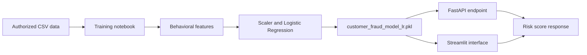

# Customer Behaviour Risk Scoring


A learning project that derives behavioral features from customer activity and estimates a low, medium, or high risk score with a Logistic Regression model. The repository pairs a FastAPI prediction endpoint with a Streamlit interface.

> **Scope:** This is a demonstration, not a validated fraud-detection or automated decision system. Do not use its output to block customers or make consequential decisions without independent validation and human review.

## What it demonstrates

- Behavioral feature engineering, including transaction frequency, bulk-order share, and weekend-order share
- Feature scaling and probability-based scoring with scikit-learn
- A JSON API through FastAPI and an interactive UI through Streamlit
- Notebook-led data preparation and model training

## Architecture



## Repository map

| Path | Purpose |
| --- | --- |
| [Api.py](Api.py) | FastAPI prediction endpoint |
| [Streamlit.py](Streamlit.py) | Interactive dashboard |
| [Customer Purchase Behaviour & Return Fraud Prediction.ipynb](Customer%20Purchase%20Behaviour%20%26%20Return%20Fraud%20Prediction.ipynb) | Data preparation and model experiments |
| [scaler.pkl](scaler.pkl) | Serialized feature scaler |
| [customer_fraud_model.pkl](customer_fraud_model.pkl) | Separate Random Forest experiment artifact |

The API and dashboard expect `customer_fraud_model_lr.pkl`. That Logistic Regression artifact is generated by the notebook and is not checked in. The checked-in Random Forest artifact is a different model and is not a drop-in replacement for that expected file.

## Run locally

The training notebook expects a local CSV dataset that is not included. Set its input path to an authorized dataset and run the training workflow first so it creates the expected model artifact. Do not commit private customer data or credentials.

```powershell
python -m venv .venv
.venv\Scripts\Activate.ps1
python -m pip install fastapi "uvicorn[standard]" streamlit pandas numpy scikit-learn
```

On macOS or Linux, activate with `source .venv/bin/activate`.

Run one interface at a time from the repository root after the model artifact exists:

```bash
# API: http://127.0.0.1:8000/docs
uvicorn Api:app --reload

# Dashboard, in another terminal
streamlit run Streamlit.py
```

## Data and model safety

- Use only datasets you are authorized to process, and remove personal identifiers before sharing.
- The model has not been established as accurate or fair for real customer decisions.
- Pickle-based artifacts can execute code when loaded; use only trusted files.
